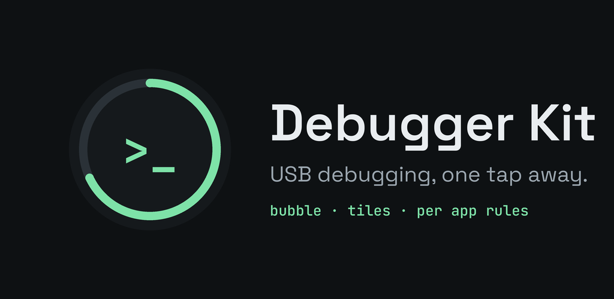
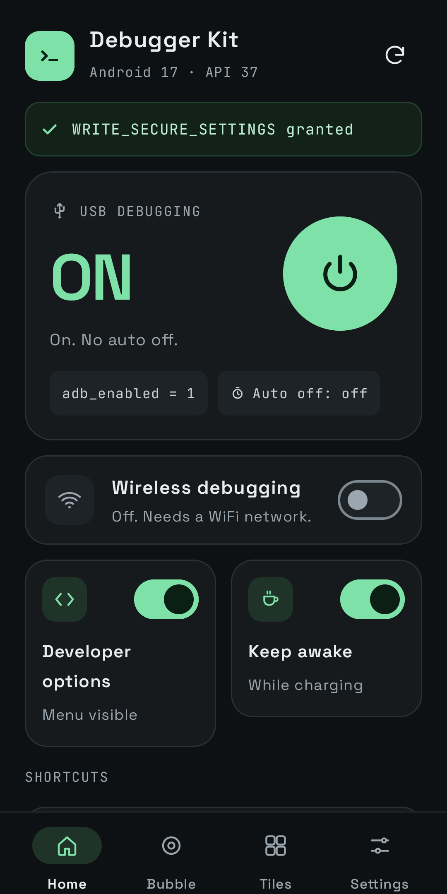
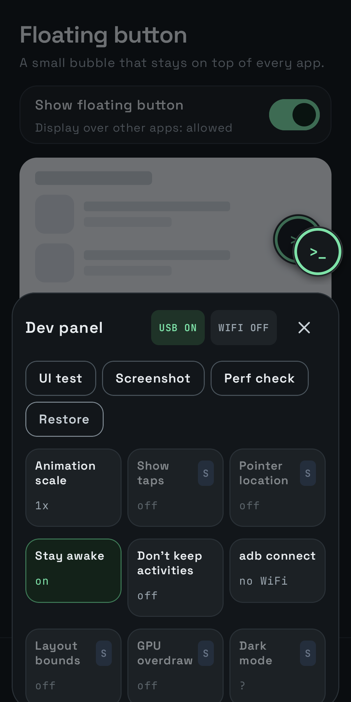
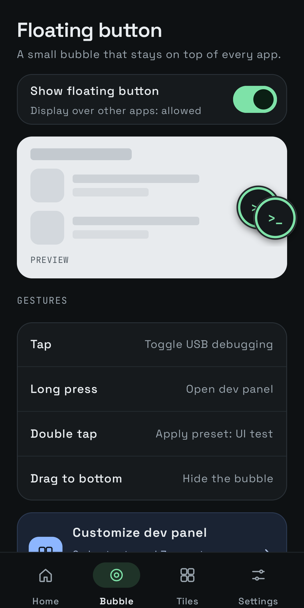
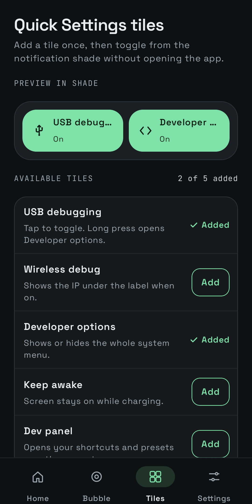

<p align="center">
  
</p>

# Debugger Kit

USB debugging, one tap away. An Android app that toggles USB debugging, wireless debugging and Developer options
from a floating bubble, Quick Settings tiles, or per app rules, plus a dev panel with the developer options you use every day.

<p align="center">
  
  
  
  
</p>

## Features

* **Floating bubble**: tap to toggle USB debugging from any app, long press for the dev panel, double tap for a preset,
  drag to the bottom to hide. A ring shows the time left before auto off. It docks into a slim edge tab when idle.
* **Quick Settings tiles**: USB debugging, wireless debug, Developer options, keep awake and the dev panel.
* **Dev panel**: animation scale, stay awake, don't keep activities, font scale, adb connect, and with Shizuku or root:
  show taps, pointer location, layout bounds, GPU overdraw, GPU bars, dark mode, demo mode, force stop, clear data and restart.
  Presets plus "Restore original".
* **Debug off per app**: banking and wallet apps that refuse to run while debugging is on get it turned off while they are open,
  and back on when you leave. Includes "Open without debugging" home screen shortcuts.
* **Safety**: optional auto off timer, keep screen on while debugging, local activity log with CSV export,
  respects device policies, no internet permission.
* **Languages**: English and Vietnamese. Follows the system language, or pick one in Settings
  (Android 13 and later also lists it under system Settings, Apps, Debugger Kit, Language).

## Install

* Google Play: coming soon.
* Or build from source (below) and install the APK.

## One time setup

Full guide for every phone brand: [docs/grant-permission.md](docs/grant-permission.md).

Android only lets an app change debug settings after `WRITE_SECURE_SETTINGS` is granted from a computer:

```bash
adb shell pm grant io.github.cuongdev.debuggerkit android.permission.WRITE_SECURE_SETTINGS
```

* **Xiaomi, HyperOS**: turn on "USB debugging (Security settings)" first.
* **OPPO, OnePlus, realme (ColorOS)**: `pm grant` fails with a SecurityException. Reinstall the installed app with
  the grant flag instead. Run it in an empty folder, it keeps app data and also grants overlay and usage access
  (tested on ColorOS 17, Android 17):

  ```bash
  adb shell pm path io.github.cuongdev.debuggerkit | tr -d '\r' | sed 's/package://' | xargs -n1 adb pull && adb install-multiple -r -g *.apk
  ```

* **Shizuku or root**: the Setup screen can grant it without a computer, and also unlocks the shortcuts marked **S**.

## What needs what

* ADB grant: USB debugging, wireless debugging, Developer options, keep awake, animation scale,
  don't keep activities, font scale.
* Shizuku or root (**S**): show taps, pointer location, layout bounds, GPU overdraw, GPU bars, dark mode, demo mode,
  target app actions, adb port.
* Display over other apps: floating bubble and dev panel.
* Usage access: Debug off per app.

## Build from source

Requires JDK 17 to 21 (Gradle 8.14 and Kotlin 2.1 do not run on JDK 25) and Android SDK 36.

```bash
./gradlew assembleDebug          # debug build, installs next to the store build as "Debugger Kit Dev"
./gradlew bundleRelease          # Play bundle
```

If your default JDK is newer, pass one explicitly: `./gradlew -Dorg.gradle.java.home=/path/to/jdk-21 bundleRelease`.
In Android Studio set Settings, Build Tools, Gradle, Gradle JDK to a JDK 21.

Release signing reads `keystore.properties` (git ignored). Copy `keystore.properties.example` and point it at your upload key.
Without it the release build is unsigned.

Publishing notes, store texts and policy answers: [docs/store/listing.md](docs/store/listing.md).

### Testing Debug off per app

Debug builds ship a small test screen, "Debug off per app test" (`testing/AutoLeaveActivity`, debug source set only,
never in release). It counts down and goes back to the home screen, so you can watch a rule turn debugging off and on
while your computer stays connected:

```bash
# 1. In the store build, add "Debugger Kit Dev" under Debug off per app.
# 2. Open the test screen; it leaves after 8 seconds (pass --ei seconds N to change it).
adb shell am start -n io.github.cuongdev.debuggerkit.debug/io.github.cuongdev.debuggerkit.testing.AutoLeaveActivity
# 3. adb drops while the rule is active, then comes back; check Settings, Activity log.
```

## Translations

Strings live in `app/src/main/res/values/strings.xml` (English) and `values-vi/strings.xml` (Vietnamese).
To add a language, copy the English file to `values-<code>/`, translate it, and add the code to
`app/src/main/res/xml/locales_config.xml` and to `LANGUAGES` in `ui/LanguageRow.kt`.

## Project layout

```
app/src/main/java/io/github/cuongdev/debuggerkit/
  core/      settings access, DebugController, auto off, prefs, activity log, snapshot, notifications
  rules/     Debug off per app: foreground watcher, safe launch, home screen shortcuts
  shell/     Shizuku user service and root runner for the "S" shortcuts
  devtools/  dev panel actions and presets
  tile/      Quick Settings tiles and the long press handler
  bubble/    floating bubble view, foreground service, dev panel overlay
  ui/        Compose screens
```

## Privacy and responsible use

Debugger Kit collects nothing and has no internet permission. See [PRIVACY.md](PRIVACY.md).

* It never overrides `DISALLOW_DEBUGGING_FEATURES` or other device policies. Managed phones show
  "Managed by your organization" instead.
* It never removes or bypasses the lock screen. Keep screen on only stops the screen timeout.
* Debug off per app turns debugging off for real. It never fakes the value other apps read.
* Only use it on devices you are allowed to debug. Company and government phones often require USB debugging to stay off
  (for example under DISA STIG configurations), so check with your IT or security team first.

## License

MIT, see [LICENSE](LICENSE). Space Grotesk and JetBrains Mono are under the SIL Open Font License 1.1.

## Author

Made by [cuong](https://github.com/cuongdev).
